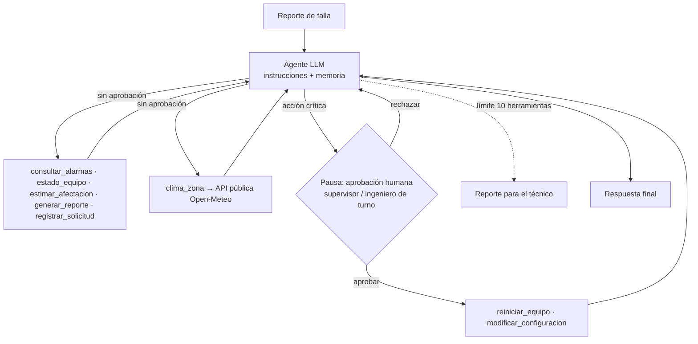

# Agente de supervisión de fallas de red

**Autor / equipo:** *(Johann Casias)*

## 1. Problema y usuario

**Problema.** En un centro de operaciones de red (NOC) de una operadora de telecomunicaciones llegan reportes de fallas todo el día. Quien está de turno tiene que revisar alarmas, consultar equipos, estimar cuántos clientes están afectados, decidir qué atender primero y detectar a tiempo las **afectaciones masivas**. Eso consume minutos valiosos, y una decisión apresurada (reiniciar un equipo crítico o cambiar una configuración) puede cortar el servicio a miles de usuarios.

**Usuario.** El ingeniero de turno y el supervisor de operaciones de red.

**Qué hace el agente.** Analiza las alarmas de una zona, consulta el estado de los equipos, estima la afectación, revisa el clima real de la zona como posible causa (tormentas que afectan energía o fibra), prioriza y genera un reporte de diagnóstico. **No toca la red por su cuenta:** reiniciar equipos y modificar configuraciones requieren la aprobación del supervisor de operaciones o del ingeniero responsable de turno.

> Todos los datos de la red (zonas, equipos, alarmas, clientes) son **simulados**. Solo el clima viene de una API pública real.

## 2. ¿Por qué un agente y no un workflow?

- **El camino no se conoce de antemano.** Una alarma crítica de uplink pide estado del equipo, afectación y clima; una alarma menor de temperatura quizá solo pida un reporte; un equipo inexistente corta el análisis. Qué herramienta usar, en qué orden y cuántas veces depende de lo que va **observando**, y eso decide el modelo en cada paso (ciclo piensa → actúa → observa).
- **Un workflow fijo** (consultar → estimar → reportar) obligaría a ejecutar siempre los mismos pasos o a programar un grafo con una rama por cada tipo de falla.
- **Costo de esa flexibilidad:** más llamadas, más latencia y riesgo de bucles o acciones indebidas. Por eso el agente lleva controles: aprobación humana en lo irreversible y un tope de 10 herramientas por incidente. La parte crítica es **determinista**: el humano siempre decide.

## 3. Arquitectura



Versión en texto:

```
 reporte de falla (texto)
        │
        ▼
 ┌──────────────────────────────── AGENTE (LLM · ciclo piensa → actúa → observa) ───────────────────────────────┐
 │  Instrucciones: PROMPT_RED          Memoria: checkpointer (un hilo por incidente)                           │
 └───────┬──────────────────────────────────────────────────────────────────────────────┬──────────────────────┘
         │ sin aprobación (solo informan)                                               │ acciones críticas
         ▼                                                                              ▼
 consultar_alarmas · estado_equipo · estimar_afectacion          ┌──────────────────────────────────────────────┐
 clima_zona ──► API pública Open-Meteo (real)                    │ CONTROL: pausa y aprobación humana           │
 generar_reporte · registrar_solicitud                           │ (supervisor de operaciones / ingeniero turno)│
         │                                                       └───────────────┬──────────────────────────────┘
         ▼                                                              aprobar │ │ rechazar
 observaciones ──► de vuelta al agente                         reiniciar_equipo · modificar_configuracion
                                                                                │
 LÍMITE: máx. 10 herramientas por incidente → el agente se detiene y entrega un reporte para el técnico
```

## 4. Los 5 primitivos

| Primitivo | Cómo está en este agente |
|---|---|
| **Instrucciones** | `PROMPT_RED` (rol, prioridades, qué puede hacer solo, qué requiere aprobación, qué hacer ante un `ERROR:` o el límite) y el *docstring* de cada herramienta, que le dice al modelo cuándo usarla. |
| **Herramientas** | 8 herramientas. Informativas: `consultar_alarmas`, `estado_equipo`, `estimar_afectacion`, `clima_zona` (**API pública real Open-Meteo**), `generar_reporte`, `registrar_solicitud`. Críticas: `reiniciar_equipo`, `modificar_configuracion`. Los errores devuelven texto que empieza con `ERROR:`. |
| **Memoria** | *Checkpointer* (`InMemorySaver`) con un `thread_id` por incidente: el agente recuerda lo ya consultado y puede **pausar y retomar** tras la decisión humana. No hay memoria entre incidentes. |
| **Estado** | La lista de mensajes del hilo (pedidos, llamadas a herramientas y observaciones) más los registros simulados `BITACORA`, `REPORTES` y `SOLICITUDES`. |
| **Control** | (1) Aprobación humana con `HumanInTheLoopMiddleware` en `reiniciar_equipo` y `modificar_configuracion`. (2) Límite de 10 llamadas a herramientas por incidente (`ToolCallLimitMiddleware`) y de llamadas al modelo. (3) Reglas de negocio en el código de las herramientas (equipos y parámetros válidos). (4) Evaluación de 5 casos. |

## 5. Cómo ejecutarlo

1. Abrir el notebook en Colab y guardar una copia. Configurar `GROQ_API_KEY` en los Secretos de Colab.
2. `Entorno de ejecución › Ejecutar todo`. Las celdas de demo muestran el caso normal, el caso con error y el control en acción; la última evaluación ejecuta los 5 casos con el agente real y calcula el porcentaje.
3. Compartir con "Cualquier persona con el enlace puede ver" y con las salidas visibles.

## 6. Limitaciones

Datos simulados; el modelo puede variar entre ejecuciones, por lo que el porcentaje de la evaluación no es idéntico cada vez; el clima es solo una pista de causa, no una confirmación; la API pública puede fallar o tardar, y en ese caso el agente recibe un `ERROR:` y debe explicarlo.
